# BLACK SOULS II — QoL Pack

**Version 1.02 · Russian and English game versions · Windows 10/11**

[**Download the pack and installer**](https://github.com/VasyTarasov/bs2-looking-glass/releases/latest) · [Google Drive mirror](https://drive.google.com/file/d/15SWTxKYxn0LpaGEv0tr7uiWNPAS_PK8m/view?usp=drivesdk) · [Steam guide (English)](https://steamcommunity.com/sharedfiles/filedetails/?id=3830468719) · [Version history](CHANGELOG.md)

Extract the **entire** release ZIP and run `Install.cmd`. Python and the required libraries are included; no additional installations or internet connection are needed to install the pack.

Tested with Larry Russian translation (base 1.01 and fixes 1.06), the older BS2RU_v5 translation, clean English Steam data, two English restoration archives, and RMModLoader 2.4–2.6, including the Forge translation layout. Install your translation or restoration patch before QoL Pack. Recognition no longer requires an exact archive hash or rejects a build simply for its language or extra scripts. Changed database objects use live properties in reference cards. DisplayMod must be removed first; arbitrary gameplay overhauls are not guaranteed compatible.

## Contents

- [Introduction](#section-01)
- [Installation](#section-02)
- [First launch](#section-03)
- [Detailed reference cards and damage previews](#section-04)
- [Combat controls and weapons](#section-05)
- [Effects, enemies, and journal](#section-06)
- [Automatic item use](#section-07)
- [Action sequences](#section-08)
- [Equipment, books, souls, and saves](#section-09)
- [Map, display, and settings](#section-10)
- [Updating and removal](#section-11)
- [FAQ and troubleshooting](#section-12)

## Introduction

### What the pack does

There is plenty you may want to check while playing BLACK SOULS II: what damage type a boss uses, where an effect came from, how many actions you have left this turn, what a weapon provides, what a skill does, or which attack to use against your chosen enemy. QoL Pack puts this information into in-game reference cards and adds quick ways to use your arsenal.

The aim is to make the game more intuitive and predictable: easier to understand on a first playthrough, with less busywork for level 1, difficulty 9 speedrunners.

[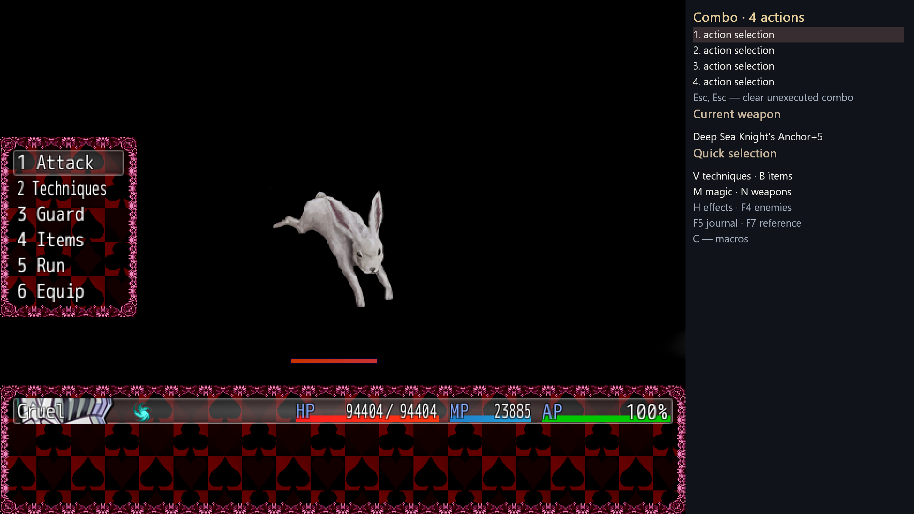](docs/assets/guide/en-01.png)

Main features:

- **F7 reference cards:** properties, restrictions, formulas, costs, and supported previews.
- **V/B/M/N combat menus:** techniques, items, magic, and weapons arranged into groups.
- **Effects and action queue:** participants' current states, selected actions, and the combat journal.
- **Less repetitive input:** equipment loadouts, learned-book indicators, bulk soul use, and save management.
- **Display and settings:** HD mode with a separate information panel, key bindings, volume, and running options.

## Installation

The pack supports an intact Game.rgss3a archive, unpacked data, and an existing RMModLoader installation. With Loader, keep launching through Loader.exe; the pack adds a late bootstrap without rewriting the game or translation data. The installer backs up the files it needs to change, and the modules can be removed later. No separate mod loader is required.

### Before installing

1. Close the game.
2. Back up your saves.
3. Extract the modpack archive into a separate folder outside the game directory.
4. Open the BLACK SOULS II folder through Steam: right-click the game → Manage → Browse local files. You need the folder containing Game.exe.

[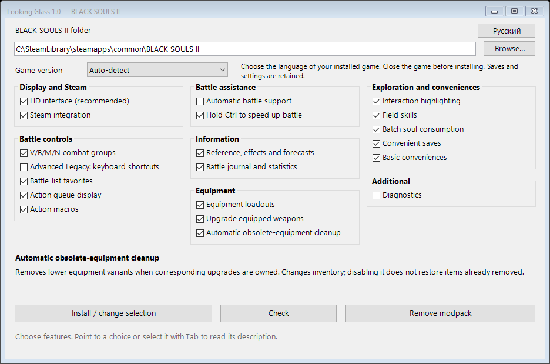](docs/assets/guide/en-02.png)

*Features are split into modules, which you can select during installation.*

- **Disabling HD resolution is not recommended.** Individual components can be disabled, but later features were developed primarily for the HD interface. It is now the recommended way to use the pack; the standard display mode is retained for compatibility.
- **Check the equipment duplicate cleanup option.** This module is enabled by default and removes excess spare equipment copies, except rings, as well as lower-tier versions. If you would rather manage your inventory yourself first, uncheck it before installing. Disabling the module will not restore items that have already been removed and saved.

### Installing

1. Run Install.cmd.
2. Select the game folder containing Game.exe.
3. Click **Install / change selection** and wait for the installation to finish successfully.
4. Launch the game normally through Steam. Open the mod settings and check that the selected features are available.

[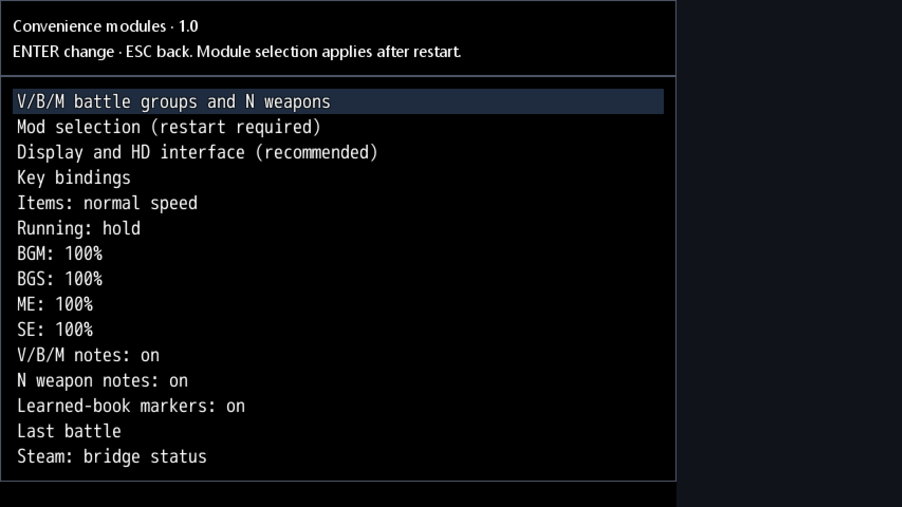](docs/assets/guide/en-03.png)

## First launch

All keys below are the defaults. If you have rebound them, follow the current on-screen hints.

1. **Open the mod settings.** Check the key bindings and display settings.
2. **Try F10.** It switches between the original window and your selected HD mode.
3. **Highlight a familiar item and press F7.** Compare the details with its regular description.
4. **Press B or V in battle.** Browse the groups, select a row, and return with Esc.
5. **Open H in battle.** Use it to inspect the participants' current effects.
6. **Hold Alt on the map.** Recognized interactions will be marked; release the key to hide the markers.

That is enough to get started. From here, read whichever sections interest you.

## Detailed reference cards and damage previews

### What an item or skill does

Highlight an item, skill, or piece of equipment and press **F7**. Its detailed card explains the mechanics: costs, effects, important restrictions, and any available preview. **F8 inside the card** switches its text between Russian and English.

The original atmospheric descriptions remain in place. Open the detailed card when you want numbers and properties. Long cards can be scrolled; the available controls are shown in their on-screen hints.

[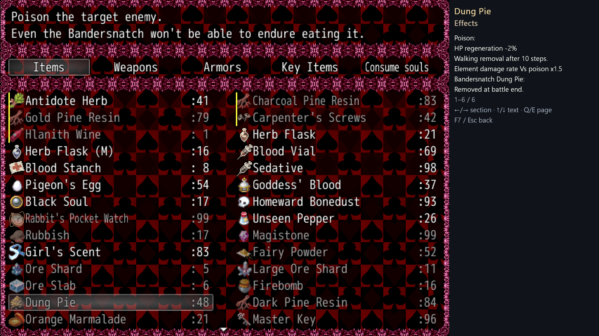](docs/assets/guide/en-04.png)

In formulas, the action user's values are pale blue, while the target's are pale pink. Also check which resource the effect changes: HP and MP are calculated separately. An item or skill may have important additional properties beyond its main damage formula.

[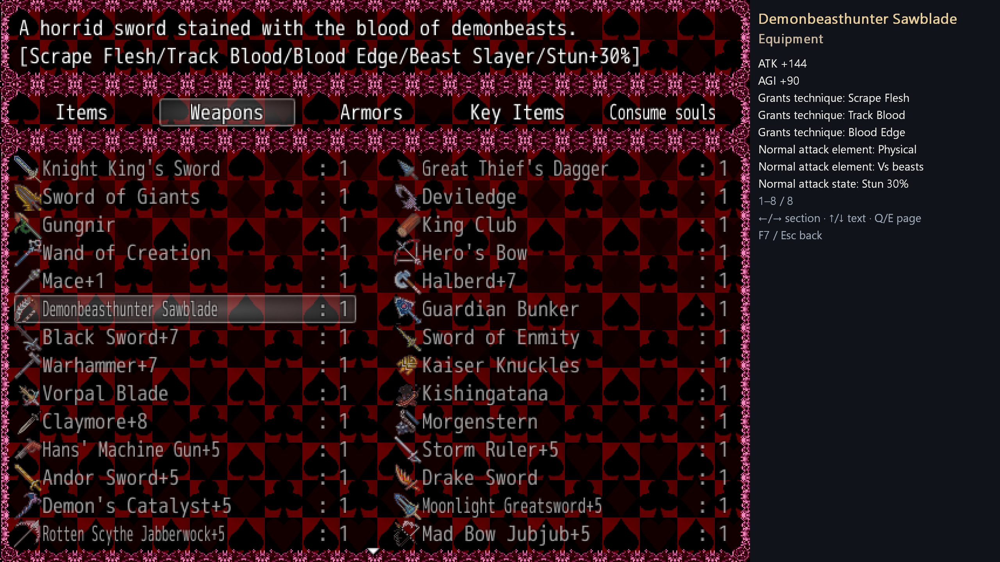](docs/assets/guide/en-05.png)

#### Reading the preview

Previews help compare your options in the current situation. They account for the target, weapon, effects, and supported properties of the selected action.

If several numbers appear before you choose a single enemy, they may be estimates for different possible targets. Do not add them together as hits from one attack. Check the labels and **F7 → By target** details. For a supported all-target attack, the sum of the means is marked separately as Σ~.

[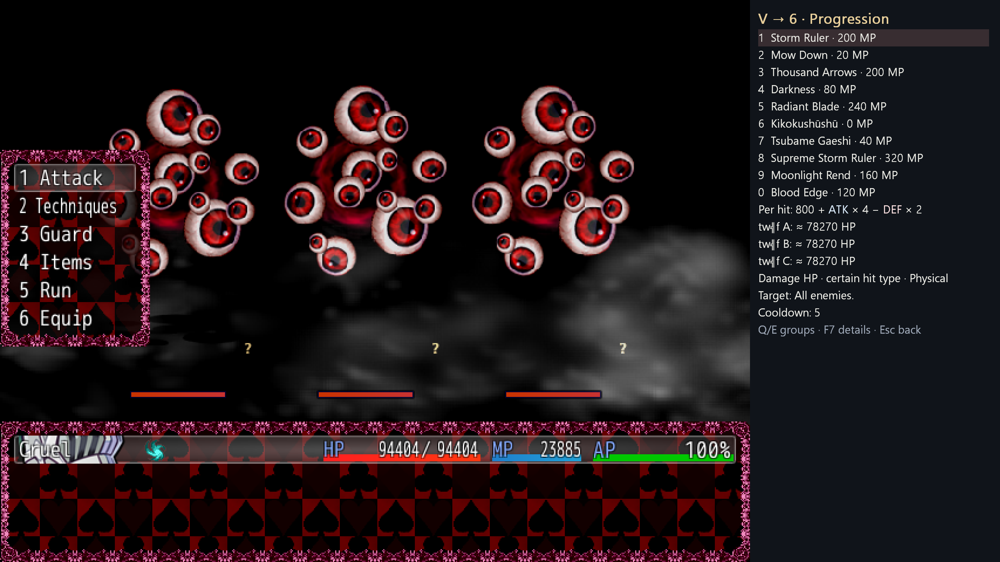](docs/assets/guide/en-06.png)

The displayed mean does not guarantee a particular result: hit chance, critical hits, and variance can change it. Pay attention to the scope of the calculation:

- **“Current state, first hit; full sequence ?”** means only the first hit has been estimated from the current state. Earlier queued actions and later hits are not included in that estimate.
- **“Direct damage; total ?”** means direct damage has been estimated, but the full result, including follow-ups or additional effects, is unknown.
- **A ? mark** means you should read the explanation beside it. The cause may be hidden information, an unsupported sequence, or a game event.

**F4 in battle** opens enemy information: stats, resistances, and special properties. The information available depends on your enemy-knowledge setting.

[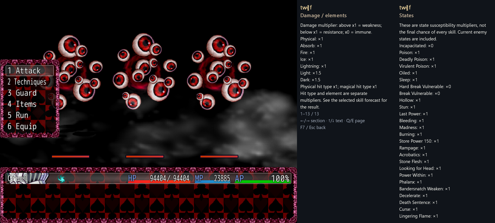](docs/assets/guide/en-07.png)

## Combat controls and weapons

### Combat menus: V, B, M, and N

Four keys give quick access to your arsenal:

- **V** — techniques.
- **B** — items.
- **M** — magic.
- **N** — weapons.

Choose a group, then an entry. Number keys match the visible positions; **Q/E** switch groups. Pressing the active menu's letter again goes back one level, while **Esc** closes the menu. In an F7 card opened from one of these menus, Q/E browse adjacent entries in the group.

[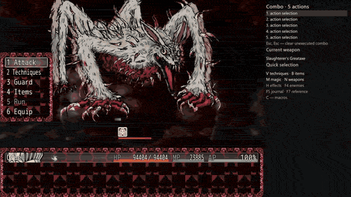](docs/assets/guide/en-08.gif)

Commands are arranged in small groups. Q/E switch groups, Esc goes back, and pressing Esc again cancels the last unexecuted action in the sequence.

After a selection, the list stays ready for another choice. Once the queue is full and the turn is executing, control resumes at that character's next input opportunity. Use Esc to leave the remembered menu.

In the regular item and technique lists, **A** adds or removes the highlighted entry from favorites, and **S** toggles the favorites filter.

[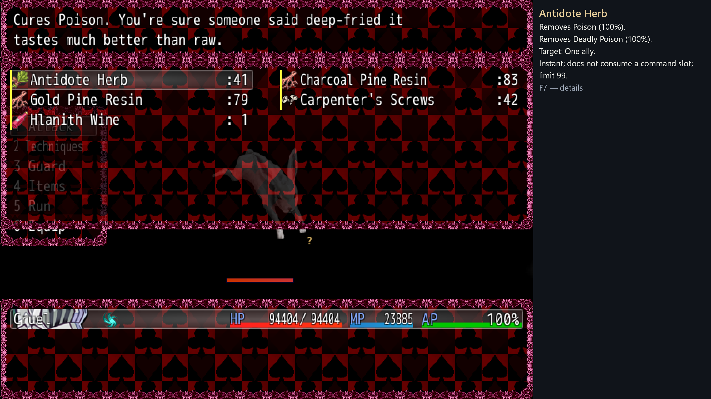](docs/assets/guide/en-09.png)

#### Three different weapon choices

**Equip now.** In N, select a weapon with its number key or Enter. For a normal attack with the highlighted weapon, use **Shift+Enter** or **Shift+number**.

**Assign a starting weapon.** In Equipment or Items → Weapons, press **D** on the weapon. It will be equipped once, at your first controllable input in battle. Press D again to clear the assignment.

**Assign the final weapon.** During battle, press **D on a weapon in N**. This is a separate assignment for the final action, subject to the action queue's weapon rules. Press D again to clear it.

Weapon techniques, normal attacks, and magic follow different weapon rules. For example, with one original action slot, a technique keeps its source weapon. Changing weapons later can also affect the stats used by an earlier queued action: selecting an action does not freeze its stats. Check F7 for the particular action.

#### Action queue and cancellation

The queue shows the actions you have selected. **Esc** lets you cancel choices that have not executed; two separate quick Esc presses clear the unexecuted queue.

**Instant items already used, resources already spent, and actions already executed remain in effect.** Clearing the queue does not rewind the battle.

#### Faster battle presentation

With **“Ctrl in battle: instant animations”** enabled, hold Ctrl to shorten animations and presentation pauses. Release it to return to normal presentation. You still choose commands and targets yourself. Loading assets and running the game calculations still take time.

## Effects, enemies, and journal

**H in battle** opens the participants and their current effects. Select a participant to inspect the details. This helps you check which buffs are active, what has changed, and what to consider before your next action.

Durations here use internal ATB counters. A number beside an effect does not guarantee the same number of full player-controlled turns.

[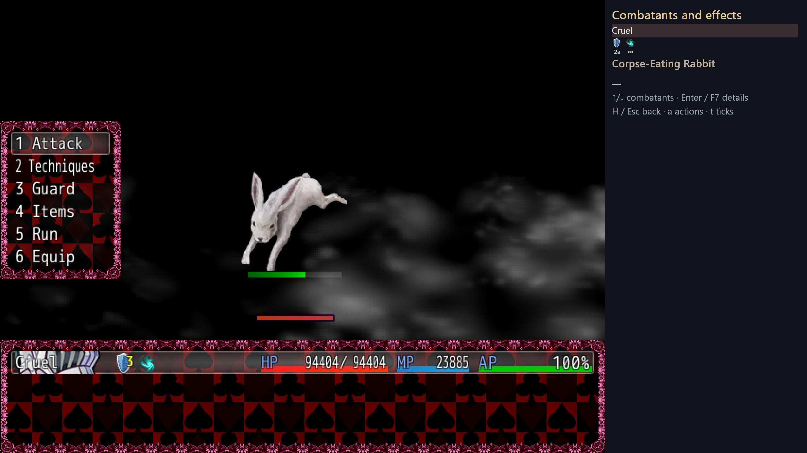](docs/assets/guide/en-10.png)

**F4** opens enemy information and resistances. What you can see depends on your enemy-knowledge setting. **F5** opens the journal and statistics; the journal lets you inspect attacks you have already observed.

[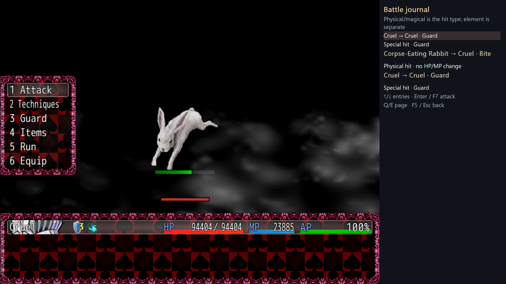](docs/assets/guide/en-12.png)

If tempo stars beside AP gauges are enabled, a filled star marks the first enemy predicted to act before the hero, while a hollow star marks another enemy that may also act first. A ? indicates uncertainty. New actions and state changes can alter this preview.

## Automatic item use

You can let automatic support maintain selected effects. **Every battle starts with automatic items disabled.**

To enable an individual entry:

1. During battle, open the regular item list or B.
2. Highlight a supported item.
3. Press **D** and check its enabled indicator.
4. Press D on that entry again to disable it.

D enables the selected item for this battle. Uses consume your stock; enable it again in the next battle.

The setting applies only to that entry and the current battle. Specific items and certain Gun Break actions are supported; you cannot enable an arbitrary skill this way.

Automatic support checks stock, usability, and current effects. It does not refresh a fresh buff unnecessarily, and cleansing items are used for matching removable states. Deliberately applied Madness is preserved. Individual items retain their own rules; for example, Hlanith Wine can be used no more than once per battle.

**Items are actually consumed.** Watch your stock and disable the entry when you no longer need it maintained. Simply browsing a selection menu or reading a reference card should not consume support items just because you highlighted them.

Field Stealth is configured separately: highlight it in field skills and press D to enable automatic renewal. Repeated casts cost MP; dialogue, events, and unfinished map transitions block application.

[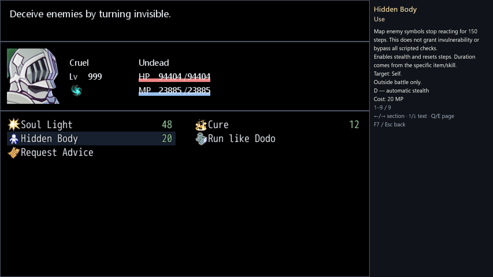](docs/assets/guide/en-14.png)

## Action sequences

Action sequences, or macros, are useful when you regularly enter the same series of actions. The editor has four groups, up to eight presets per group, and up to six action rows per preset. This feature requires the V/B/M/N groups module and the macros module. Equipment loadouts can be disabled.

Start with a simple sequence you have already used manually:

1. Open **Macros** in the mod settings; the editor is also available when equipment loadouts are disabled.
2. Select a preset and give it a recognizable name.
3. Fill the rows using the available V/B/M/N lists. Check the order and the targets of friendly actions.
4. Save it with **Save**. Leaving the editor without saving discards the preset's unsaved changes.

In battle, press **C → group number → preset number**, then choose a target if required. Before confirmation, you can see how many action slots the sequence uses, its MP cost, and its cooldown readiness.

[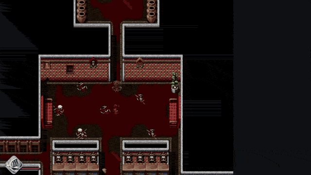](docs/assets/guide/en-15.gif)

The sequence must fit into your remaining action slots. Availability is checked again during execution: if an item, MP, or another requirement becomes unavailable, the rest of the sequence may stop. Completed actions and their costs remain in effect.

## Equipment, books, souls, and saves

#### Loadouts and weapon upgrades

Save several loadouts to change defensive equipment without selecting every slot again. A loadout stores your shield, headgear, armor, and rings. **Your weapon stays as it is.**

Available copies and locked slots are checked before applying a loadout. Comparisons show the main stats; open the details for special properties and resistances.

[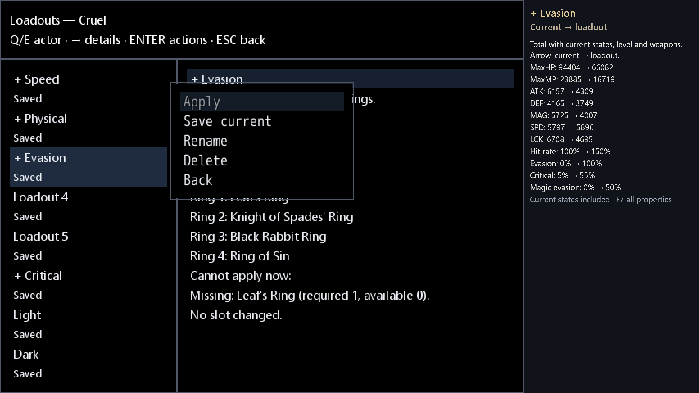](docs/assets/guide/en-16.png)

The equipped-weapon upgrade module lets you use normal recipes without unnecessary equipment changes. Material requirements and costs remain the same as in the game.

#### Books and souls

Book indicators apply to the selected character. They help identify what has already been learned; a skill granted by equipped gear is tracked separately from one learned permanently.

[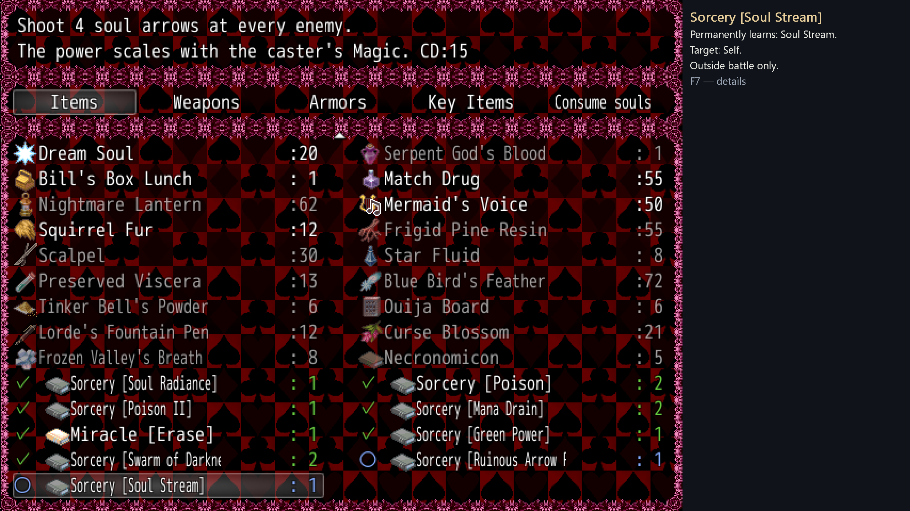](docs/assets/guide/en-17.png)

**Consume Souls** lets you use eligible souls in bulk. Check the category and total consumption before confirming. **Black souls change SEN.** Colored souls are also consumed when used.

[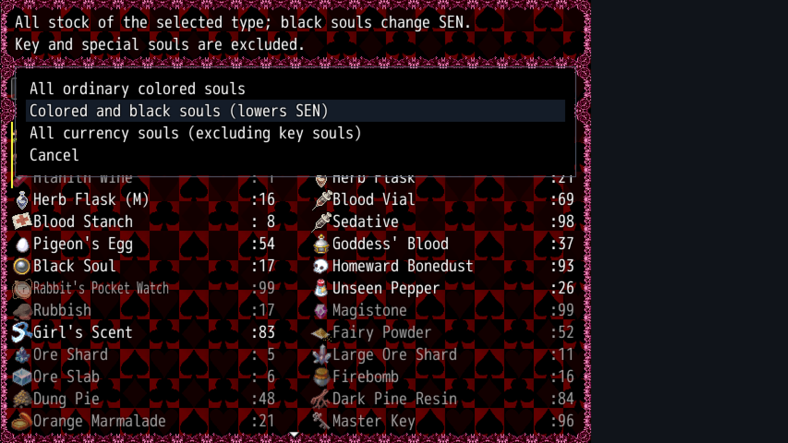](docs/assets/guide/en-18.png)

#### Duplicate cleanup

This module removes excess spare copies of weapons and defensive equipment, as well as lower-tier versions in linear upgrade families. **Rings of every tier are kept, regardless of quantity.**

Before using it, decide whether you want to keep spare equipment. Make your own save backup beforehand. If cleanup has already happened and you have saved the result, disabling the module will not restore the removed items.

#### Saves

Regular saves can be named and sorted; there are **100 manual slots**. **F3 on the map** creates a quicksave in a separate rotating set of **five slots**.

Quicksaving is unavailable during events, transitions, or other game-imposed restrictions. Keep manual saves too if you want a lasting return point.

[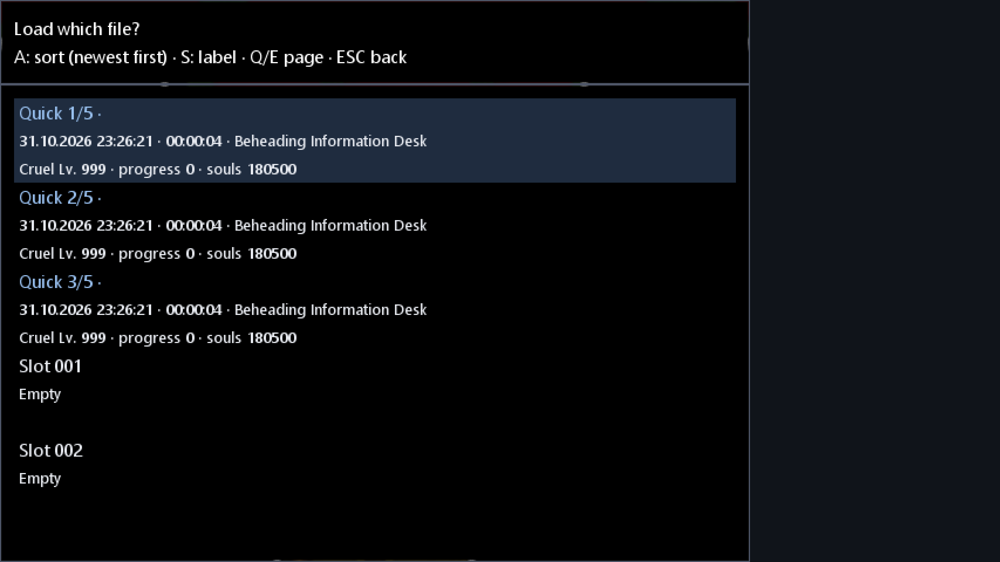](docs/assets/guide/en-19.png)

The five quicksave slots rotate independently of manual saves.

## Map, display, and settings

#### Interaction highlighting

Hold **Alt on the map** to mark recognized available interactions. Release the key to hide the markers. Highlighting takes current conditions into account; some complex events may not be recognized.

[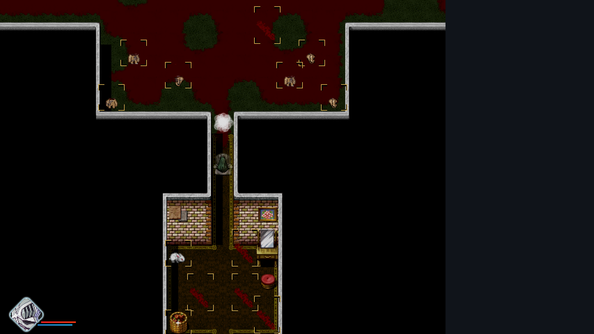](docs/assets/guide/en-20.png)

**G** uses the Gear of Madness through its normal game event, provided you have the item and the conditions allow it. SEN selection remains manual. The corresponding dialogue also accepts **1/2/3**.

[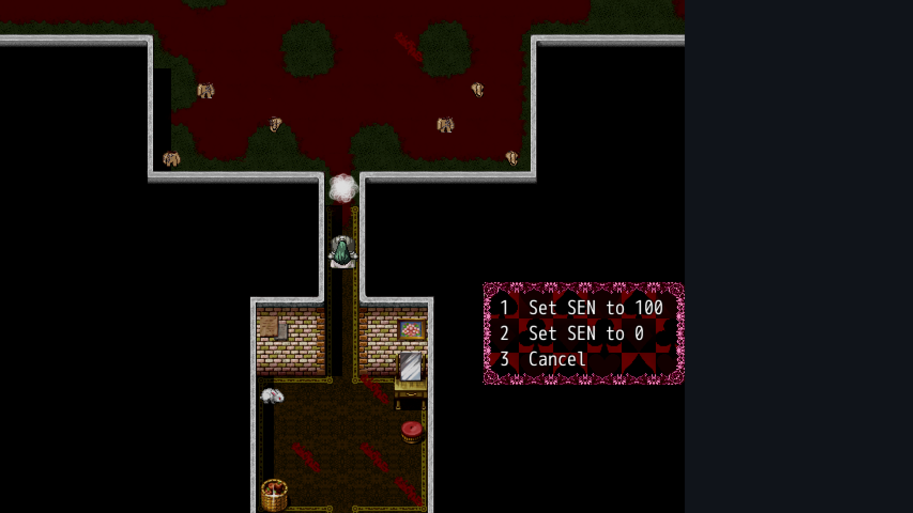](docs/assets/guide/en-21.png)

#### HD mode

Choose a size in the display settings, then use **F10** to switch between the original window and the selected HD mode. A monitor-sized preset opens in borderless fullscreen; a smaller preset runs in a window. Fullscreen on startup is a separate setting. New achievement notifications display correctly.

The original game frame is scaled, while the information panel and its text are rendered separately. Clarity and usability may depend on resolution, Windows scaling, and your hardware.

[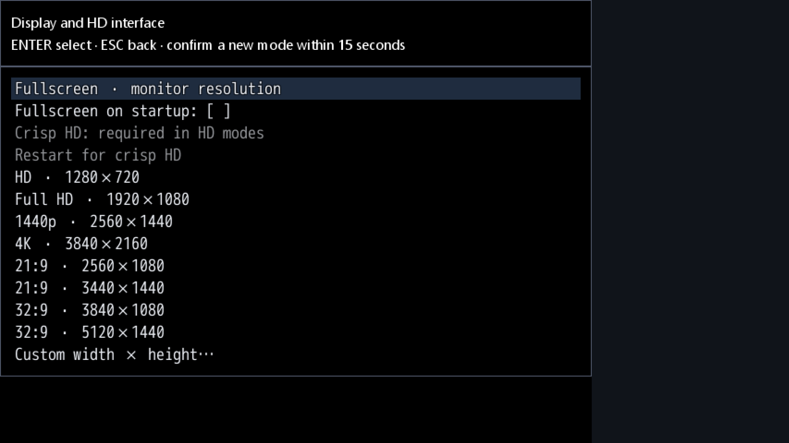](docs/assets/guide/en-22.png)

#### Keys, sound, and running

You can change key bindings, volume, and running behavior in the settings. Follow the on-screen hints while getting started: the same key may perform different actions in different windows.

[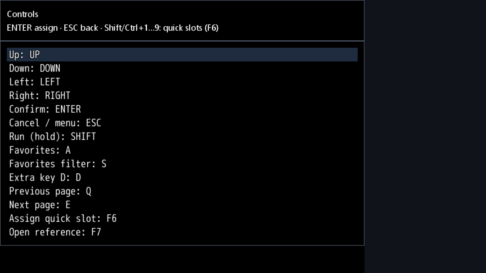](docs/assets/guide/en-23.png)

#### Steam bridge: overlay and screenshots

The **Steam / OpenGL** module enables the Steam overlay and screenshots, including in HD mode. Enable it during installation and launch the game through Steam. Open the overlay with your Steam shortcut, usually **Shift+Tab**.

[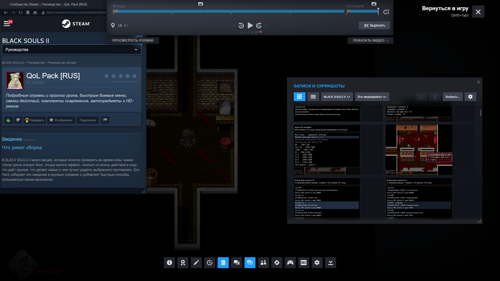](docs/assets/guide/en-25.png)

Choose a Steam screenshot key other than **F12**: with the bridge enabled, F12 is used to return to the title screen through a restart.

## Updating and removal

#### Updating an installed pack

1. Close the game and keep your own backup of important saves.
2. Extract the new archive separately.
3. Run **Update.cmd** and select the installed game as directed by the updater.
4. Wait for the result. The updater checks that it recognizes the installed version and creates a backup.
5. Restart the game and check the version and settings.

#### Changing the module selection or removing modules

Close the game and use **Install.cmd → Install / change selection** to change the selected modules. Use **Remove modpack** to uninstall them. Restoring the original scripts requires the correct verified backup; keep it while using the pack. Removing modules leaves saves and local user data in place.

#### Compatibility

- **Other translations, script mods, loaders, and DisplayMod:** untested; correct operation is not guaranteed.
- **Steam overlay, screenshots, achievements, video recording, and export:** tested in my configuration.
- **Steam Deck/Linux and all GPU/DPI combinations:** untested; correct operation is not guaranteed.

## FAQ and troubleshooting

Please report problems with the pack in the comments or on GitHub. If an issue is reproducible or appears to be system-related, enable the diagnostics module if possible, run **Collect-debug.cmd**, and attach the resulting report to your message.

I completed the entire game with this pack and did not encounter any serious issues or problems that prevented progress.

Suggestions for the pack and reports about compatibility with other mods are welcome too. If an idea is useful and fits the pack, I will try to implement it.
