# BLACK SOULS II — QoL Pack

**Версия 1.02 · Русская и английская версии игры · Windows 10/11**

[**Скачать модпак с готовым установщиком**](https://github.com/VasyTarasov/bs2-looking-glass/releases/latest) · [Зеркало: Google Drive](https://drive.google.com/file/d/15SWTxKYxn0LpaGEv0tr7uiWNPAS_PK8m/view?usp=drivesdk) · [История изменений](CHANGELOG-RU.md) · [Version history](../CHANGELOG.md)

Распакуйте **весь** ZIP из раздела Releases и запустите `Install.cmd`. Python и необходимые библиотеки уже включены; отдельная установка и интернет для установки модпака не нужны. 

[Руководство в Steam](https://steamcommunity.com/sharedfiles/filedetails/?id=3830469599)

Проверены перевод Larry до и после исправлений 1.06, старый BS2RU_v5, чистая английская Steam-версия, два английских восстановительных архива и RMModLoader 2.4–2.6, в том числе структура перевода Forge. Сначала установите русификатор или восстановительный патч, затем QoL Pack. Установщик больше не требует точного совпадения архива и не отказывает только из-за языка или дополнительных скриптов. Для изменённых объектов справки используют актуальные свойства. DisplayMod нужно предварительно удалить; совместимость с произвольными модами, меняющими игровой процесс, не гарантируется.

## Содержание

- [Введение](#section-01)
- [Установка](#section-02)
- [Первый запуск](#section-03)
- [Подробные справки и прогноз урона](#section-04)
- [Боевое управление и оружие](#section-05)
- [Эффекты, противники и журнал](#section-06)
- [Автопредметы](#section-07)
- [Связки действий](#section-08)
- [Снаряжение, книги, души и сохранения](#section-09)
- [Карта, экран и настройки](#section-10)
- [Обновление и удаление](#section-11)
- [Частые вопросы и решение проблем](#section-12)

## Введение

### Что умеет сборка

В BLACK SOULS II много вещей, которые хочется проверить во время игры: каким типом урона атакует босс, откуда взялся эффект, сколько осталось действий в ходу, что даёт оружие, что делает навык и чем лучше ударить выбранного противника. QoL Pack собирает эти сведения в игровых справках и добавляет быстрые способы пользоваться своим арсеналом.

Цель — сделать игру более интуитивной и предсказуемой. Понятной для новичка и менее рутинной для 1sl 9dif спидраннера.

[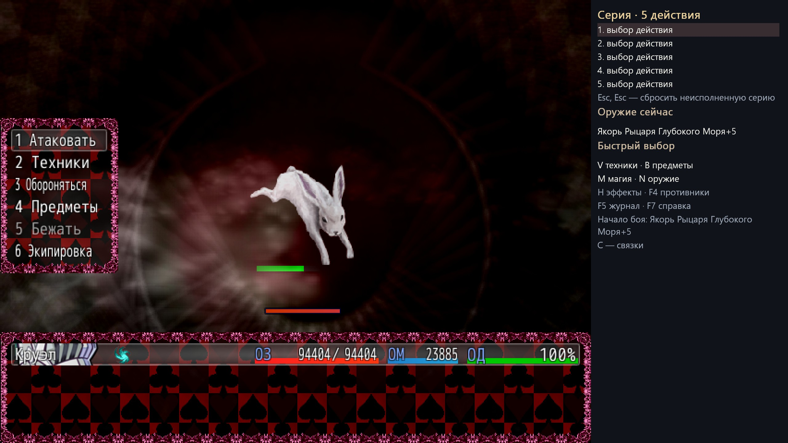](assets/guide/01-introduction-01.jpg)

Основные возможности:

- **Справки F7:** свойства, ограничения, формулы, затраты и поддерживаемые прогнозы.
- **Боевые меню V/B/M/N:** техники, предметы, магия и оружие, разложенные по группам.
- **Эффекты и очередь:** текущие состояния участников, выбранные действия и боевой журнал.
- **Меньше повторяющихся действий:** комплекты, отметки изученных книг, массовое использование душ и организация сохранений.
- **Настройки представления:** HD-режим с отдельной панелью сведений, назначения клавиш, громкость и бег.

## Установка

**Скачать можно в разделе Releases на странице GitHub:**

[https://github.com/VasyTarasov/bs2-looking-glass](https://github.com/VasyTarasov/bs2-looking-glass)

Модпак работает с нераспакованным Game.rgss3a, распакованными данными и уже установленным RMModLoader. При использовании Loader продолжайте запускать игру через Loader.exe: модпак добавляет позднюю загрузку своих модулей и не переписывает данные игры или перевода. Установщик сделает копию необходимых файлов и модули можно легко удалить. Модлоадер не требуется.

### Перед установкой

1. Закройте игру.
2. Сделайте резервную копию сохранений.
3. Распакуйте архив модпака в отдельную папку вне игры.
4. Откройте папку BLACK SOULS II через Steam: свойства/управление игрой → просмотр локальных файлов. Нужен каталог с Game.exe.

### Установка

1. Запустите Install.cmd.
2. Укажите корректный путь до каталога с Game.exe.
3. Нажмите **Install / change selection** и дождитесь успешного завершения.
4. Запустите игру обычным способом через Steam. Откройте игровые настройки модпака и проверьте, что выбранные возможности появились.

[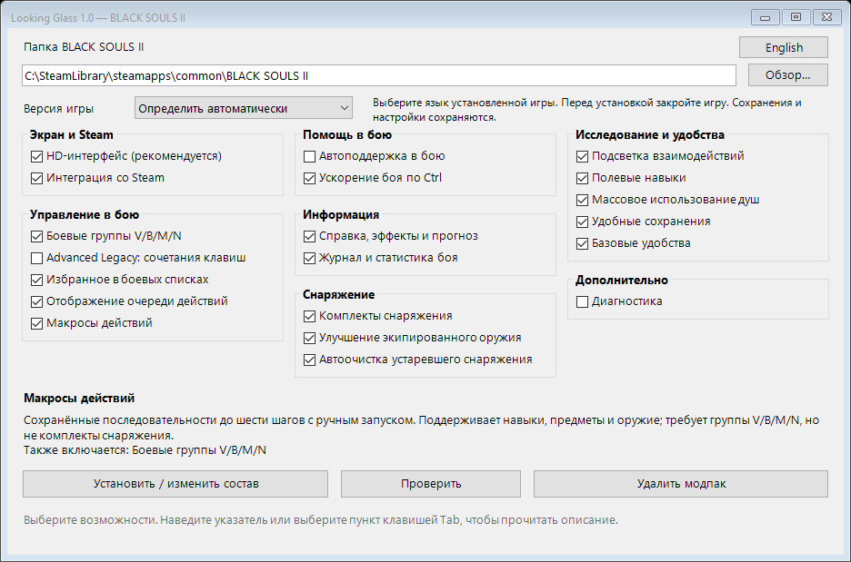](assets/guide/02-installation-01.png)

*Возможности разбиты на модули. Их можно выбирать при установке.*

- **Отключать HD разрешение не рекомендуется.** Модпак позволяет отключать отдельные компоненты, однако поздние функции разрабатывались прежде всего с расчётом на HD-интерфейс. Сейчас это основной рекомендуемый режим работы сборки, обычный режим сохранён для совместимости.
- **Отдельно проверьте «Убирать дубли снаряжения».** Этот модуль включен по умолчанию и удаляет лишние запасные экземпляры экипировки (за исключением колец) и младшие версии. Если хотите сначала разобраться с инвентарём самостоятельно, снимите флаг до установки. Уже удалённые и сохранённые вещи отключением модуля не вернуть.

    [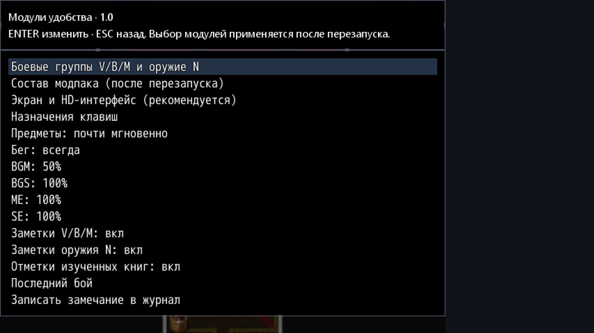](assets/guide/02-installation-02.jpg)

## Первый запуск

Все клавиши ниже указаны по умолчанию. Если вы их переназначили, ориентируйтесь на текущие подсказки в игре.

1. **Откройте настройки модпака.** Посмотрите назначения клавиш и настройки экрана.
2. **Попробуйте F10.** Клавиша переключает исходное окно и выбранный HD-режим.
3. **Выделите знакомый предмет и нажмите F7.** Сравните подробности с обычной подсказкой.
4. **В бою нажмите B или V.** Посмотрите группы, выберите строку и вернитесь через Esc.
5. **Откройте H в бою.** Здесь удобно проверять текущие эффекты участников.
6. **На карте удержите Alt.** У распознанных взаимодействий появятся отметки; отпустите клавишу, чтобы скрыть их.

Этого достаточно, чтобы начать пользоваться сборкой. Дальше можно читать только интересующие разделы.

## Подробные справки и прогноз урона

### Справки: что делает предмет или навык

Выделите предмет, навык или снаряжение и нажмите **F7**. Подробная карточка показывает механику объекта: цену, эффекты, важные ограничения и доступный прогноз. **F8 внутри справки** переключает русский и английский текст справки.

Обычное атмосферное описание остаётся на своём месте. Когда нужны цифры и свойства, открывайте подробности. Длинную карточку можно прокручивать; доступные действия указаны в её подсказках.

[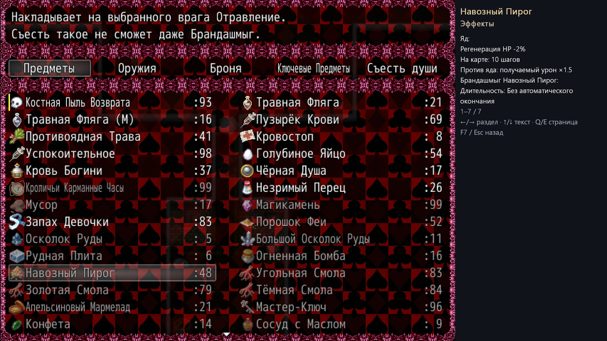](assets/guide/04-references-01.jpg)

В формулах светло-голубым выделены величины пользователя действия, светло-розовым — цели. Смотрите также, какой ресурс затрагивает эффект: HP и MP рассчитываются отдельно. У предмета или навыка могут быть существенные дополнительные свойства, которые не сводятся к основной формуле урона.

[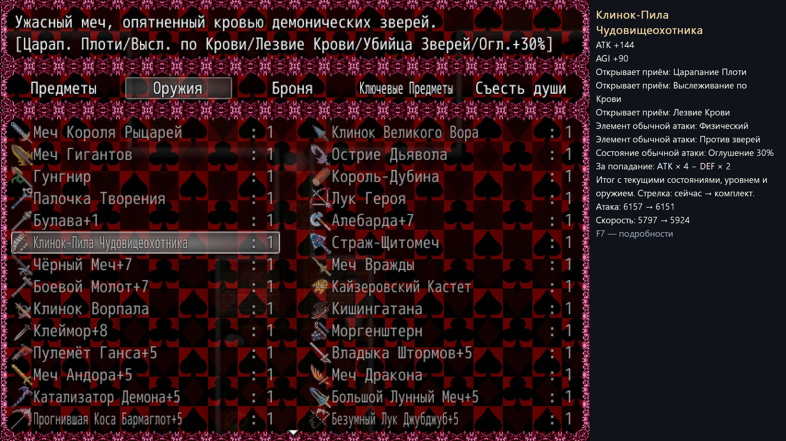](assets/guide/04-references-02.jpg)

#### Как читать прогноз

Прогноз помогает сравнивать варианты в текущей ситуации. На него влияют цель, оружие, эффекты и поддерживаемые особенности выбранного действия.

Если перед выбором одного врага показано несколько чисел, это могут быть оценки для разных возможных целей. Не складывайте их как попадания одной атаки. Смотрите подписи и подробности **F7 → По целям**. Для поддерживаемой атаки по всем целям сумма средних отдельно помечается Σ~.

[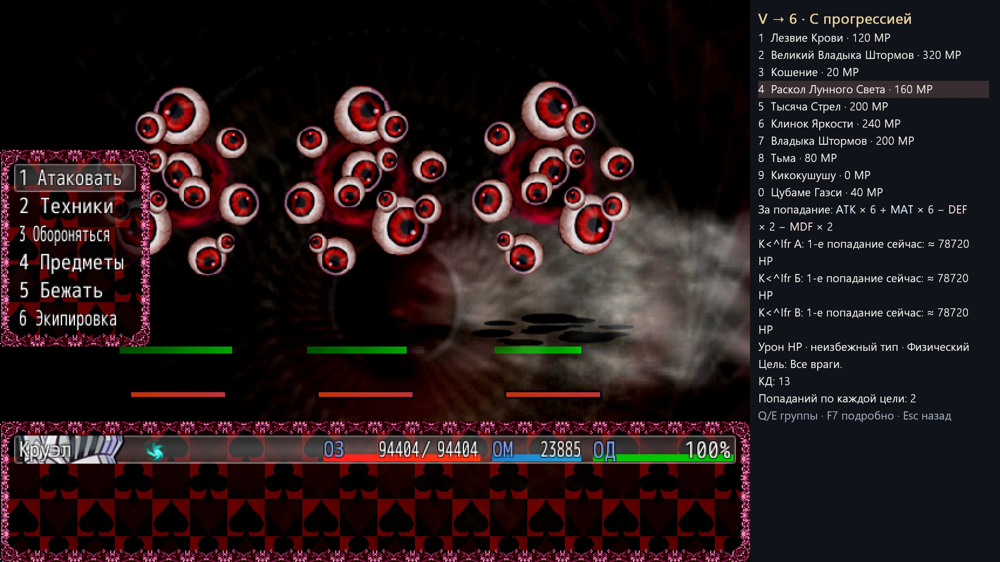](assets/guide/04-references-03.jpg)

Показанное среднее не гарантирует конкретный результат: попадания, критические удары и разброс могут его изменить. Важны и ограничения расчёта:

- **«Сейчас, первое попадание; серия ?»** — оценено первое попадание по текущему состоянию. Предыдущие действия очереди и продолжение серии в эту оценку не входят.
- **«Прямой урон; итог ?»** — прямой урон оценён, но полный результат с продолжением или дополнительными эффектами неизвестен.
- **Знак ?** требует прочитать пояснение рядом. Причиной могут быть скрытые сведения, неподдерживаемая последовательность или игровое событие.

**F4 в бою** открывает сведения о противниках: характеристики, сопротивления и особенности.

Доступность информации зависит от настройки знакомства с врагами.

## Боевое управление и оружие

### Боевые меню: V, B, M и N

Четыре клавиши открывают быстрый доступ к арсеналу:

- **V** — техники.
- **B** — предметы.
- **M** — магия.
- **N** — оружие.

Выберите группу, затем нужную строку. Цифры соответствуют видимым позициям; **Q/E** переключают группы. Повторное нажатие активной буквы возвращает на уровень выше, **Esc** закрывает меню. В справке F7, открытой из такого меню, Q/E позволяют просматривать соседние объекты группы.

[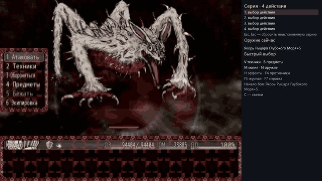](assets/guide/05-battle-controls-01.gif)

*Команды выбираются из небольших групп; Q/E меняют группы, Esc возвращает назад, повторное нажатие Esc отменяет последнее невыполненное действие в связке.*

После выбора список остаётся готовым к следующему действию. Когда очередь заполнена и ход выполняется, управление возобновится при следующем вводе этого персонажа. Выход через Esc позволяет покинуть запомненное меню.

В обычных списках предметов и техник **A** добавляет выделенную позицию в избранное или убирает её оттуда, **S** переключает фильтр избранного.

[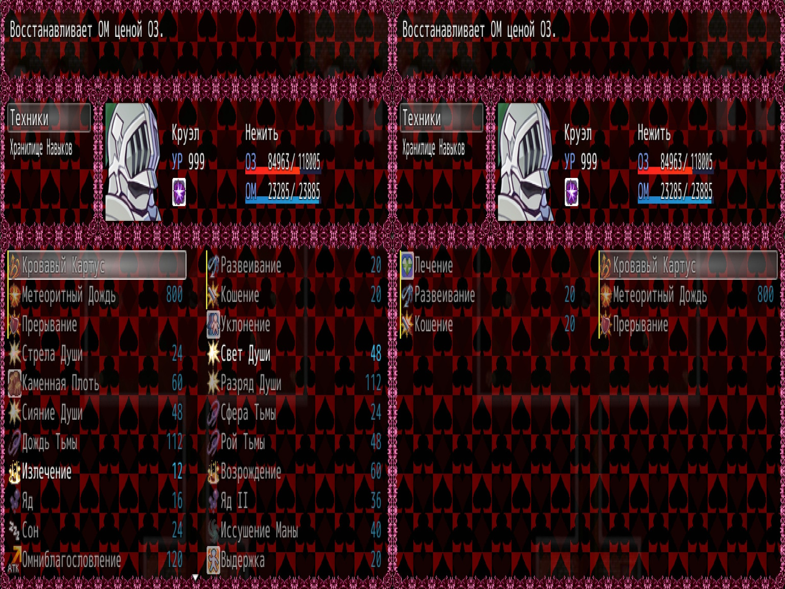](assets/guide/05-battle-controls-02.png)

#### Три разных решения об оружии

**Сменить оружие сейчас.** В N выберите оружие цифрой или Enter. Для обычной атаки выбранным оружием используйте **Shift+Enter** или **Shift+цифру**.

**Назначить стартовое оружие.** В снаряжении или «Предметы → Оружие» нажмите **D** на нужной вещи. Она будет надета один раз при первом управляемом вводе боя. Повторное D снимает назначение.

**Назначить конечного исполнителя.** Во время боя нажмите **D на оружии в N**. Это отдельное назначение для последнего действия по правилам боевой очереди. Повторное D снимает его.

Техника оружия, обычная атака и магия используют оружие по разным правилам. Например, при одном исходном действии техника сохраняет своё оружие-источник. Поздняя смена оружия также может повлиять на параметры ранее выбранного действия: очередь не замораживает характеристики при каждом выборе. Для конкретного варианта проверяйте F7.

#### Очередь и отмена

Очередь показывает уже выбранные действия. **Esc** позволяет отменять ещё не выполненный выбор; два отдельных быстрых нажатия Esc очищают невыполненную очередь.

**Уже применённые мгновенные предметы, потраченные ресурсы и выполненные действия остаются в силе.** Очистка очереди не является откатом боя.

#### Быстрый показ боя

При включённой настройке **«Ctrl в бою: мгновенные анимации»** удерживайте Ctrl, чтобы сократить анимации и паузы показа. Отпустите — обычный показ вернётся. Команды и цели по-прежнему выбираете вы. Загрузка ресурсов и сами игровые расчёты всё равно занимают время.

## Эффекты, противники и журнал

**H в бою** открывает участников и текущие эффекты. Выберите участника, чтобы посмотреть подробности. Это помогает понять, какой бафф действует, что изменилось и что стоит проверить перед следующим действием.

Длительности здесь связаны с внутренними счётчиками ATB. Число рядом с эффектом не обещает столько же полных управляемых ходов.

[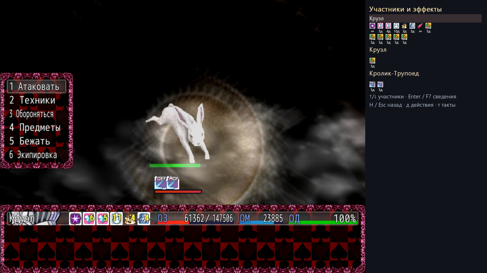](assets/guide/06-effects-journal-01.jpg)

**F4** открывает сведения о противниках и сопротивлениях. Их доступность зависит от настройки знакомства. **F5** открывает журнал и статистику; через журнал можно разбирать уже наблюдавшиеся атаки.

[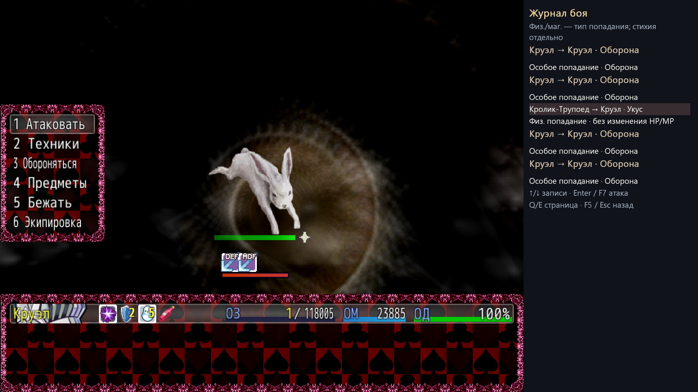](assets/guide/06-effects-journal-02.jpg)

Если включены звёзды темпа у шкал AP, заполненная звезда отмечает первого врага, который по поддерживаемому прогнозу опережает героя, пустая — другого возможного опережающего врага. ? обозначает неопределённость. Новые действия и изменения состояния могут поменять этот прогноз.

## Автопредметы

Поддержание выбранных эффектов можно поручить автоматике. **Каждый бой начинается с выключенными автопредметами.**

Чтобы включить конкретную позицию:

1. Во время боя откройте обычный список предметов или B.
2. Выделите поддерживаемый предмет.
3. Нажмите **D** и проверьте отметку включения.
4. Чтобы выключить эту позицию, снова нажмите D на ней.

[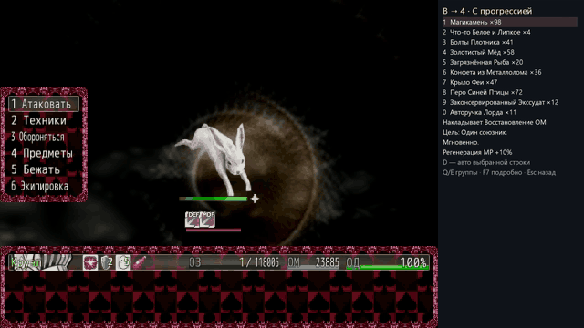](assets/guide/07-auto-items-01.gif)

*D включает выбранный предмет в этом бою. Применения расходуют запас; в следующем бою включите заново.*

Включение относится только к этой строке и текущему бою. Поддерживаются определённые предметы и отдельные Gun Break; произвольный навык таким способом включить нельзя.

Автоматика учитывает наличие предмета, условия применения и текущие эффекты. Свежий бафф не обновляется без необходимости; очищения срабатывают для подходящего снимаемого состояния. Намеренное Безумие сохраняется. У отдельных вещей остаются собственные правила — например, Хланитское Вино применяется не более одного раза за бой.

**Расход настоящий.** Следите за запасом и отключайте строку, когда поддержание больше не нужно. Пока вы просто читаете справку или просматриваете меню выбора, поддержка не должна тратить предметы из-за одного наведения.

Полевая скрытность настраивается отдельно: выделите её в полевых навыках и нажмите D для автообновления. Повторные применения оплачиваются MP; диалоги, события и незавершённые переходы блокируют применение.

[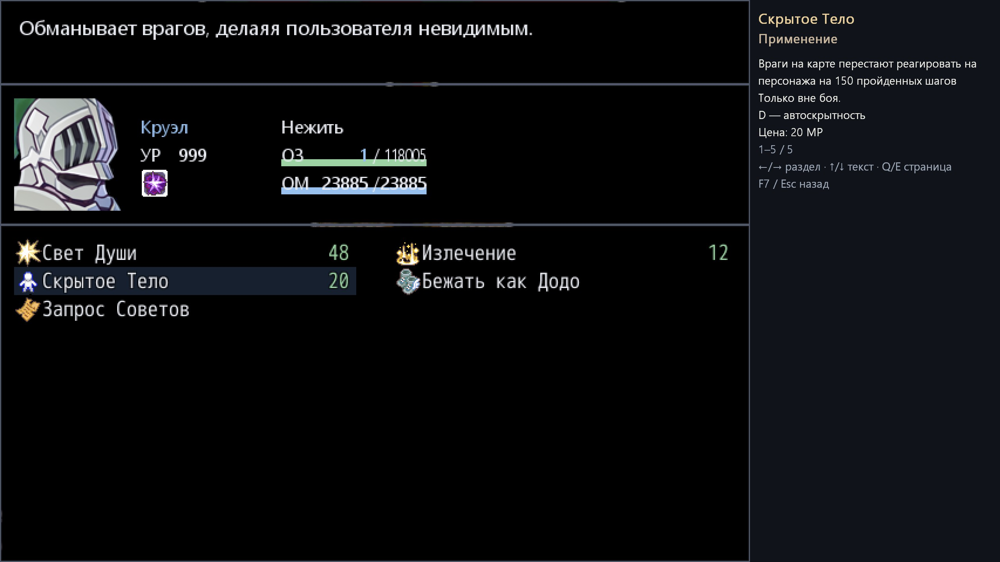](assets/guide/07-auto-items-02.jpg)

## Связки действий

Связки полезны, когда вы регулярно вводите одну и ту же последовательность. В редакторе есть четыре группы, в каждой — до восьми наборов, в наборе — до шести строк действий. Для этой возможности нужны модуль групп V/B/M/N и модуль связок. Комплекты можно отключить.

Начните с простой последовательности, которую уже выполняли вручную:

1. Откройте **«Связки»** в настройках модпака; редактор доступен и при отключённых комплектах.
2. Выберите набор и задайте понятное имя.
3. Заполните нужные строки через доступные списки V/B/M/N; проверьте порядок и цели дружественных действий.
4. Сохраните набор командой **Save**. Выход из редактора без сохранения не сохраняет черновик набора.

В бою нажмите **C → цифру группы → цифру набора**, затем выберите цель, если это требуется. Перед подтверждением видны число действий, занимающих слоты очереди, MP и готовность по времени восстановления.

Связка должна помещаться в оставшиеся слоты действий. При выполнении доступность проверяется снова: если позже не хватит предмета, MP или другой возможности, остаток связки может остановиться. Выполненные действия и их цена при этом сохраняются.

## Снаряжение, книги, души и сохранения

#### Комплекты и улучшение оружия

Сохраните несколько комплектов, чтобы менять защитное снаряжение без повторного перебора каждого слота. Комплект хранит щит, головной убор, броню и кольца. **Оружие остаётся текущим.**

Перед применением проверяются доступные экземпляры и заблокированные слоты. Сравнение показывает основные параметры; особые свойства и сопротивления открывайте в подробностях.

[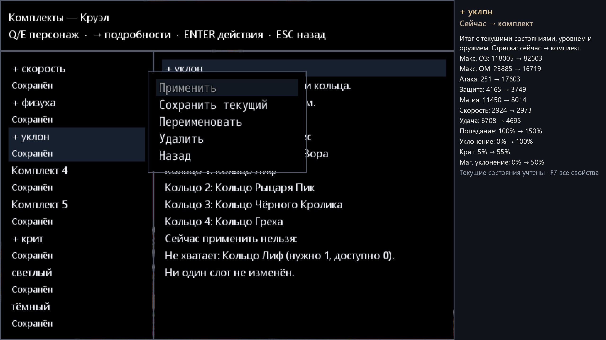](assets/guide/09-equipment-saves-01.jpg)

Модуль улучшения надетого оружия позволяет пользоваться обычными рецептами без лишнего переодевания. Материалы и стоимость остаются игровыми.

#### Книги и души

Отметки книг относятся к выбранному персонажу. Они помогают отличить уже изученное; навык от надетой вещи учитывается отдельно от выученного навсегда.

[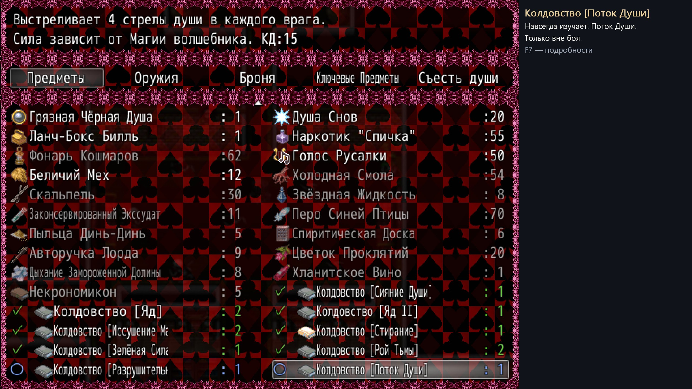](assets/guide/09-equipment-saves-02.jpg)

Команда **«Съесть души»** позволяет массово использовать подходящие души. Перед подтверждением проверьте категорию и итоговый расход. **Чёрные души меняют SEN.** Цветные души тоже расходуются при применении.

[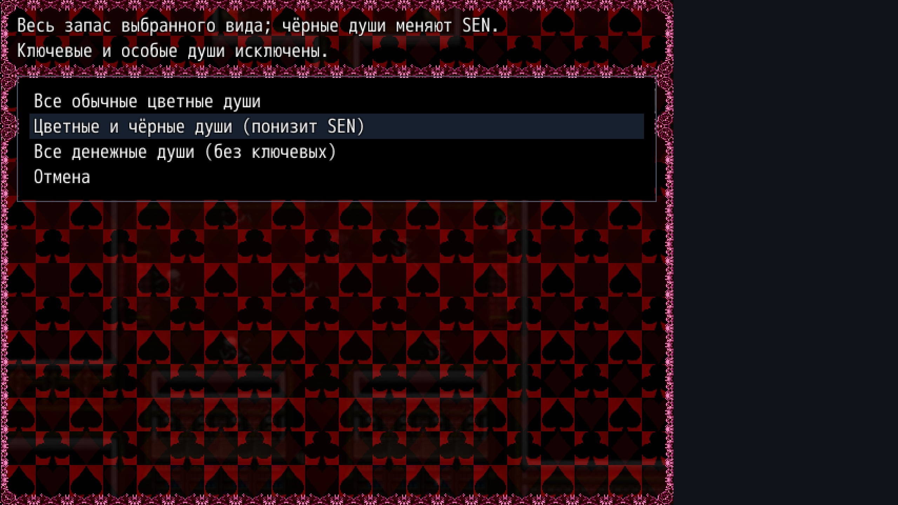](assets/guide/09-equipment-saves-03.jpg)

#### Очистка дублей

Этот модуль убирает лишние запасные экземпляры оружия и защитного снаряжения, а также младшие линейные версии. **Кольца всех уровней и в любом количестве сохраняются.**

Перед использованием решите, хотите ли вы хранить запасные вещи. Свою резервную копию сохранений лучше сделать заранее. Если очистка уже произошла и результат сохранён, выключение модуля удалённое не восстановит.

#### Сохранения

Обычные сохранения можно подписывать и сортировать; доступно **100 ручных слотов**. **F3 на карте** выполняет быстрое сохранение в отдельную вращающуюся группу из **пяти слотов**.

Быстрое сохранение не выполняется во время события, перехода или другого игрового запрета. Сохраняйтесь и вручную, если нужна постоянная точка возврата.

[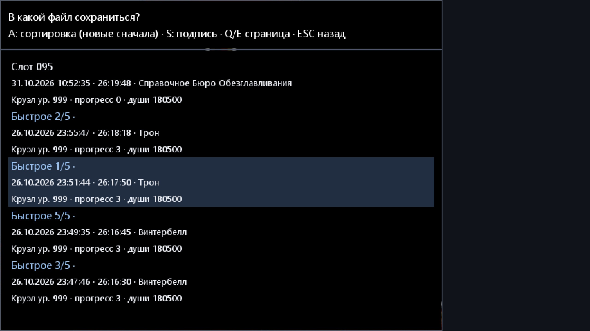](assets/guide/09-equipment-saves-04.jpg)

*Пять быстрых слотов вращаются отдельно от ручных сохранений.*

## Карта, экран и настройки

#### Подсветка взаимодействий

Удерживайте **Alt на карте**, чтобы отметить распознанные доступные взаимодействия. Отпустите клавишу — отметки исчезнут. Подсветка учитывает текущие условия; некоторые сложные события могут не распознаваться.

[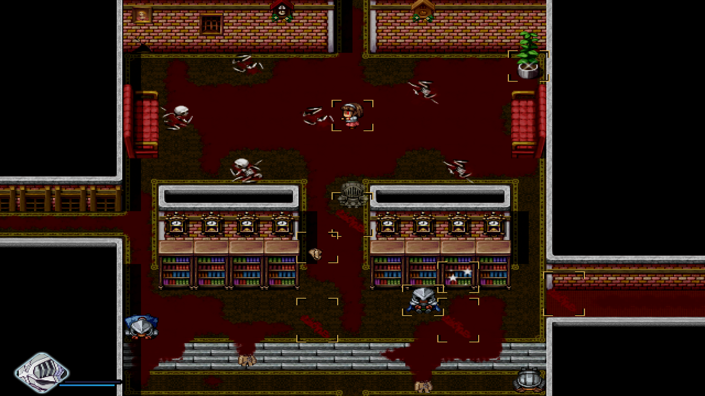](assets/guide/10-map-display-01.png)

**G** использует Шестерню Безумия через её обычное событие, если предмет доступен и условия позволяют. Выбор SEN остаётся ручным. В соответствующем диалоге работают также цифры **1/2/3**.

[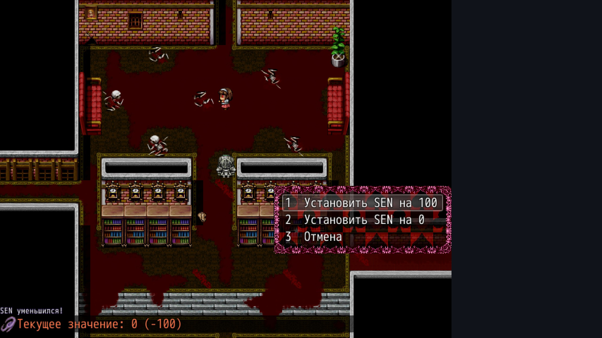](assets/guide/10-map-display-02.jpg)

#### HD-режим

Выберите размер в настройках экрана, затем используйте **F10** для переключения между исходным окном и выбранным HD-режимом. Пресет размером с монитор открывается без рамки на весь экран; меньший размер используется как окно. Запуск сразу в полном экране задаётся отдельно. Выпадение новых достижений отображается корректно.

Исходный игровой кадр масштабируется, а панель сведений и её текст выводятся отдельно. Чёткость и удобство могут зависеть от разрешения, масштабирования Windows и устройства.

[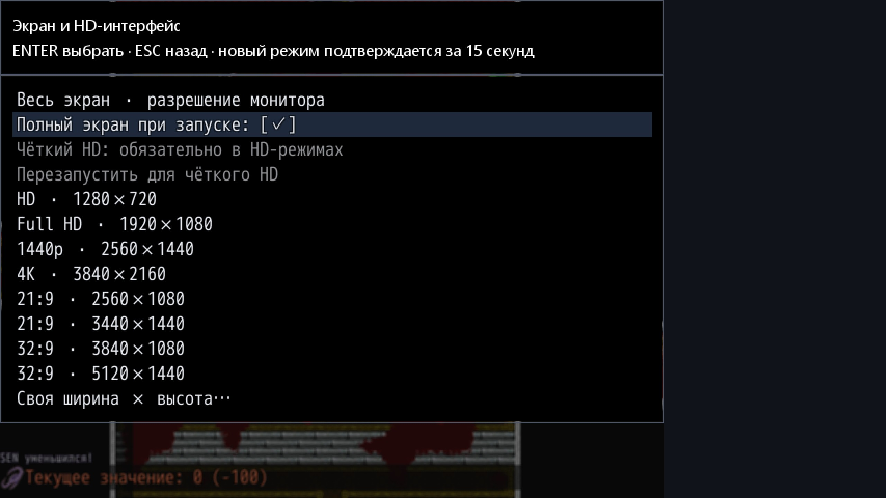](assets/guide/10-map-display-03.jpg)

#### Клавиши, звук и бег

В настройках можно изменить назначения, громкость и поведение бега. Для начала ориентируйтесь на экранные подсказки: одна и та же клавиша может выполнять разные действия в разных окнах.

[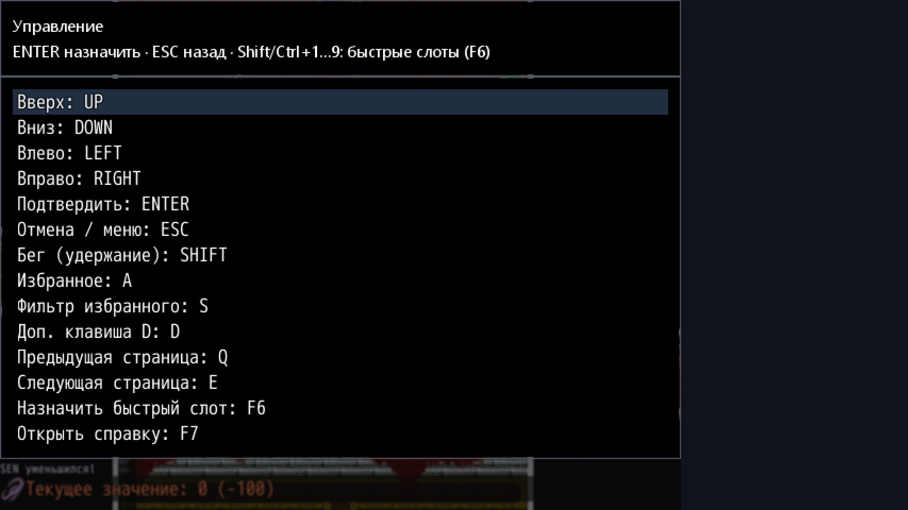](assets/guide/10-map-display-04.jpg)

#### Steam-мост: оверлей и скриншоты

Модуль **Steam / OpenGL** позволяет пользоваться оверлеем Steam и делать скриншоты, в том числе в HD-режиме. Включите его при установке и запускайте игру через Steam. Оверлей открывается назначенным в Steam сочетанием — обычно **Shift+Tab**.

[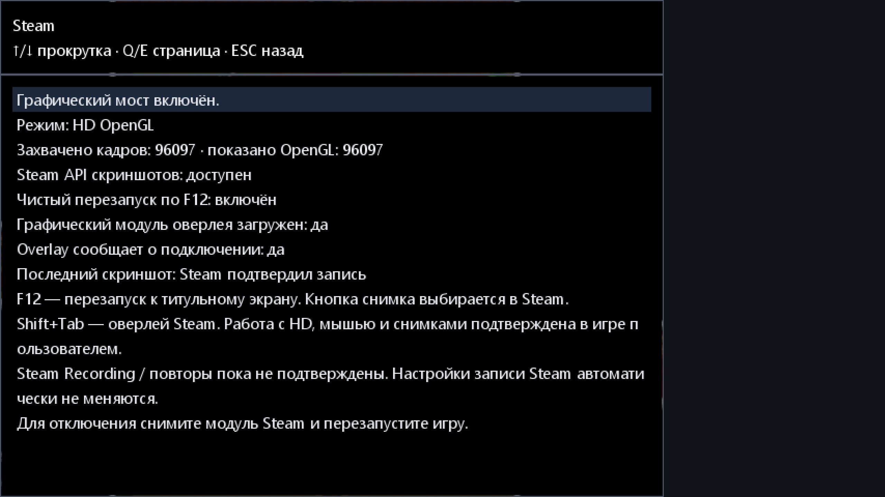](assets/guide/10-map-display-05.jpg)

Для скриншотов выберите в настройках Steam клавишу, отличную от **F12**: с мостом F12 используется для возврата к титулу через перезапуск.

## Обновление и удаление

#### Обновить установленную сборку

1. Закройте игру и сохраните собственную копию важных сохранений.
2. Распакуйте новый архив отдельно.
3. Запустите **Update.cmd** и выберите установленную игру согласно подсказкам обновителя.
4. Дождитесь результата. Обновитель проверяет известную установленную версию и создаёт резервную копию.
5. Запустите игру заново и проверьте версию и настройки.

#### Изменить набор или удалить модули

Для изменения набора закройте игру и используйте **Install.cmd → Install / change selection**. Для удаления используйте **Remove modpack**. Восстановление исходных скриптов требует подходящей проверенной резервной копии; не удаляйте её, пока пользуетесь сборкой. Удаление модулей оставляет сохранения и локальные пользовательские данные.

#### Совместимость

- **Другие переводы, скриптовые моды, загрузчики и DisplayMod:** не тестировались, корректность работы не гарантирована.
- **Оверлей и скриншоты Steam, достижения, запись и экспорт видео:** проверено в моей конфигурации.
- **Steam Deck/Linux, все сочетания GPU/DPI:** не тестировались, корректность работы не гарантирована.

## Частые вопросы и решение проблем

Пишите о встреченных проблемах с модпаком в комментариях или на GitHub. Если проблема воспроизводится регулярно или выглядит системной, по возможности установите модуль диагностики и приложите к сообщению его вывод Collect-debug.cmd.

Я полностью прошёл игру с этой сборкой и серьёзных или мешающих прохождению проблем не встретил.

Также буду рад предложениям по модпаку и сообщениям о совместимости с другими модами. Если идея окажется полезной и уместно впишется в сборку, постараюсь её реализовать.
